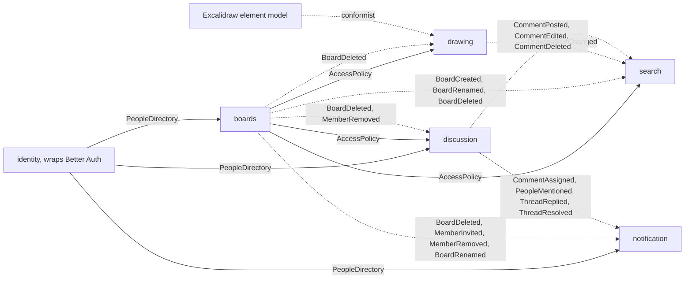

# Bounded contexts of narbel

Status: accepted by the owner on 2026-10-30, with every decision as recommended. Migration steps 1 to 3 are done. Each later step starts only after the owner confirms it.

This document splits the server's `features/board` module into bounded contexts, defines how the contexts talk, and lists the current behavior that the split must keep. It also covers the matching frontend changes. Every "today" claim cites the code it comes from, so a reviewer can check it.

## Why split at all

`apps/server/src/features/board` holds 38 use cases, 12 application ports, 4 transports (HTTP, WebSocket, MCP, file), and 5 jobs: drawing, sharing, discussion, search, and rendering. One word carries two meanings inside it. "Board" is a thing a person owns and shares, and "board" is also the document people draw on. The two meanings follow different rules: access changes never touch pages or elements, and element edits never touch access. That seam is where the first boundary goes.

The symptoms of the missing boundaries are in the code today:

- Search joins other contexts' tables in raw SQL: `DrizzleBoardSearch.ts` joins `board_access` and `comment`.
- Sharing reads Better Auth's `user` table: `DrizzleBoardAccessRepository.ts:55`.
- A repository read writes data: `findMemberRole` sets `board_access.user_id` on the first match (`DrizzleBoardAccessRepository.ts:14-43`).
- Discussion writes email rows into the outbox directly: `CommentEvents.ts:54`, `:93`.
- Rules live in use cases instead of the aggregate. The rule "a locked board needs a password" sits in `UpdateBoardAccess.ts`, while `Board.withProtection` accepts any combination.

## The contexts

| Context | Kind | Purpose | Owns these tables |
| --- | --- | --- | --- |
| `drawing` | core | The content of a board: pages, elements, images, connectors, labels, layout, and z-order. Module `live` holds sync, presence, follow, and agent selection. Module `render` draws a page to PNG for agents. | `board_document`, `board_file` |
| `boards` | supporting | A board as a thing a person owns and shares: create, rename, delete, visibility, password, members, invitations, share links, and unlock. | `board`, `board_access`, `board_share` |
| `discussion` | supporting | Threads pinned to a page: replies, mentions, reactions, assignment, and resolution. | `comment`, `comment_reaction` |
| `identity` | generic | Accounts, sessions, API keys, and MCP OAuth through Better Auth. Module `profile` holds usernames, display names, and avatars. | Better Auth tables, `profile` |
| `notification` | generic | The in-app inbox, the unread count, and email delivery through the outbox. | `notification`, `outbox` |
| `search` | supporting | A read model that answers "which boards I can read mention this text". | `board_text` and a new `search_comment` table |

MCP is not a context. It is a transport, like HTTP, that calls the application services of `drawing`, `discussion`, and `boards`. It has no rules of its own.

Each context gets one schema file, `packages/db/src/schema/<context>.ts`, and only that context's infrastructure may import it. Another context refers to a row only by its id.

### Cuts that were considered and rejected

| Option | Contexts | Why not |
| --- | --- | --- |
| Coarser | 4: `boards` and `drawing` merged, search as a module | Keeps the two meanings of "board" in one model, so access rules stay mixed with scene rules. |
| Finer | 8: `live`, `render`, `profile`, and `sharing` separate | `live` and `render` use the same words as `drawing` (page, element). Separating them creates two contexts that call each other on every request. |

## Ubiquitous language

The words of each context, with their meaning and the neighbour's word they must not be confused with, are in [glossary.md](glossary.md). Class, method, event, and route names come from it. A new word enters the glossary in the same pull request as the code that needs it.

## Talking across contexts

Contexts talk in two ways. A context asks another context a question through an open-host service, in-process, when the answer must be current. A context tells others what happened through an integration event.

### Ask: `AccessPolicy`, owned by `boards`

Every board request needs an access decision, including the WebSocket handshake. The decision must reflect revocation at once, because today a removed member loses access on their next request. So access stays a synchronous in-process call, not a copied projection.

```ts
type Actor =
  | { kind: "anonymous" }
  | { kind: "person"; personId: PersonId; email: Email }
  | {
      kind: "agent";
      personId: PersonId;
      email: Email;
      via: "api-key" | "oauth";
    }
  | { kind: "share-guest"; token: ShareToken }
  | { kind: "unlock-guest"; proof: UnlockProof };

type Need = "read" | "write" | "owner";

interface AccessPolicy {
  decide(
    boardId: BoardId,
    actor: Actor,
    need: Need
  ): Promise<Result<Access, AccessDenied>>;
  readableBoardIds(personId: PersonId, email: Email): Promise<BoardId[]>;
  people(boardId: BoardId): Promise<{ owner: PersonId; members: Grant[] }>;
}
```

`decide` replaces `BoardAccessGuard.require` (`application/BoardAccess.ts`) for all 33 callers. `readableBoardIds` replaces the `readable` CTE in `DrizzleBoardSearch.ts` and the joins in `listSharedWith`. `people` replaces `memberIdsOf` in `BoardPeople.ts:9-17`, which discussion uses for assignees and mentions.

The decision rules move unchanged from `domain/rules/resolveAccess.ts` into the `Board` aggregate. The list in [Behavior the split must keep](#behavior-the-split-must-keep) is the acceptance test for `decide`.

### Ask: `PeopleDirectory`, owned by `identity`

`PeopleDirectory.find(ids)` and `PeopleDirectory.byUsernames(names)` replace `IProfileReader` in `shared/application/interfaces/IProfiles.ts`. Only `identity` reads the `user` and `profile` tables. `ProfileRepository.setName` writing `user.name` becomes an `identity` internal.

### Tell: integration events

An integration event is a fact one context publishes and others react to. The producer owns its type. The type lives in the producer's public API (`features/<context>/index.ts`), so consumers import it through the path the dependency rules already allow.

Today the side effects of a comment run in the same database transaction as the comment (`CommentEvents.ts`, called inside `uow.run`). That couples two contexts in one transaction: a failed notification insert fails the comment. The proposal changes this on purpose, following the rule of one aggregate per transaction and eventual consistency between contexts:

1. The producer writes the event into the existing `outbox` table, in the same transaction as its aggregate. The event cannot be lost, and it cannot exist without the change that caused it.
2. The unit of work's `afterCommit` hook (`DrizzleUnitOfWork.ts:46-51`) wakes the outbox worker at once. The 2-second poll stays as the fallback. The expected delay for a notification is one worker pass after commit. That delay is not measured yet; step 5 of the migration measures it.
3. Each consumer handles an event at most once. A `processed_event(consumer, event_id)` row, written in the consumer's transaction, makes a retried delivery a no-op.
4. The worker's retry, backoff, and dead-letter rules (`OutboxWorker.ts`) apply to events as they apply to email today.

Email becomes one more consumer of the same events instead of a separate message type that use cases enqueue.

Each event carries a `type` and a `version`. A payload change that removes or renames a field needs a new version.

| Event | Producer | Payload | Consumers and what they do | Today |
| --- | --- | --- | --- | --- |
| `BoardCreated` v1 | `boards` | boardId, ownerId, title | `search`: store the title. | `search` reads `board.title` live |
| `BoardRenamed` v1 | `boards` | boardId, title | `search`: update the title. | same |
| `BoardDeleted` v1 | `boards` | boardId, ownerId | `drawing`: close live peers, delete the document, files, and S3 prefix. `discussion`: delete threads. `notification`: delete notifications for the board. `search`: drop the board. | `DeleteBoard.ts:20-40` plus FK cascades |
| `MemberInvited` v1 | `boards` | boardId, boardTitle, email, inviteeId or null, inviterId, firstInvite | `notification`: if inviteeId is set and firstInvite, add `board.invited`. Enqueue email with dedupe key `invite:<boardId>:<email>`. | `InviteBoardMember.ts:50-70` |
| `MemberRemoved` v1 | `boards` | boardId, email, personId or null | `discussion`: clear that person as assignee. `notification`: forget the invite email. `drawing.live`: re-check that person's open peers (decision 1). | `RemoveBoardMember.ts:31-41` |
| `AccessChanged` v1 | `boards` | boardId | `drawing.live`: re-check every open peer of the board (decision 1). | nothing |
| `PersonDeleted` v1 | `identity` | personId | `notification`: delete the person's pending outbox rows (decision 4). | nothing |
| `CommentAssigned` v1 | `discussion` | boardId, threadId, commentId, actorId, assigneeId, excerpt | `notification`: add `comment.assigned`, enqueue email `assigned:<commentId>:<assigneeId>`. | `CommentEvents.ts:37-63` |
| `PeopleMentioned` v1 | `discussion` | boardId, threadId, commentId, actorId, recipientIds, excerpt | `notification`: one `comment.mentioned` and one email `mentioned:<commentId>:<personId>` per recipient. | `CommentEvents.ts:67-95` |
| `ThreadReplied` v1 | `discussion` | boardId, threadId, commentId, actorId, recipientIds, excerpt | `notification`: add `comment.reply` per recipient. | `CommentEvents.ts:100-120` |
| `ThreadResolved` v1 | `discussion` | boardId, threadId, actorId, recipientIds | `notification`: add `comment.resolved` per recipient. | `CommentEvents.ts:122-140` |
| `CommentPosted`, `CommentEdited`, `CommentDeleted` v1 | `discussion` | boardId, commentId, body or nothing | `search`: maintain `search_comment`. | `search` reads `comment.body` live |
| `DrawingTextChanged` v1 | `drawing` | boardId, upserts, removals | `search`: write `board_text` rows. | `DrizzleBoardDocumentStore.save`, same transaction |

Discussion decides who hears about a thread: author, assignee, and mentioned people, filtered to current members. That rule moves with the events as `recipientIds`. Notification only renders and delivers.

### Context map



Solid arrows are synchronous questions. Dotted arrows are events.

`drawing` stores and sends elements in Excalidraw's shape, because the product edits Excalidraw boards and every client speaks that format. The domain does not take that shape as its model, though. Today `SceneElement` (`domain/entities/SceneElement.ts`) is Excalidraw's element with an open `[key: string]: unknown` index, so Excalidraw's schema defines the domain. Instead, the adapter parses each stored element into a narrow domain `Element`: id, kind, page, position, size, label link, connector ends, image file, and z-order key. Every other Excalidraw field stays in an opaque `rest` that the domain carries but never reads. Rules such as connectors (`domain/rules/connectors.ts`, `bindings.ts`), labels, and layout read only the typed fields. A dependency rule keeps `@excalidraw/*` and `yjs` out of every `domain/` folder.

## Aggregates

Each aggregate is the smallest group of data that one invariant needs at the same instant. A transaction changes one aggregate. Aggregates refer to each other by id.

| Context | Aggregate | Holds | Invariants it enforces | Repository |
| --- | --- | --- | --- | --- |
| `drawing` | `Drawing` | One board's pages and elements. The Yjs document is its storage and its sync transport. | The last page cannot be deleted. Element ids are unique across pages. A label belongs to exactly one live shape. A connector end points at a live shape or at nothing. | `DrawingRepository` loads and saves through the live room. |
| `boards` | `Board` | Owner, title, visibility, password hash, and the share link (at most one). | A password board has a password hash. A share link expiry is in the future when set. The owner cannot hold a grant on their own board. | `BoardRepository` |
| `boards` | `Grant` | Board id, email, person id or nothing, role. | Role is `editor` or `viewer`. Claiming sets the person once and never changes it. | `GrantRepository` (unique board id and email, as the table has now) |
| `discussion` | `Thread` | The root comment: page, position, author, body, assignee, resolution. | Only the author edits the body. Only a member is assigned. Resolving twice is a no-op. | `ThreadRepository` |
| `discussion` | `Reply` | Thread id, author, body. | A reply is created only through `Thread.reply()`, so a reply to a reply cannot exist. | `ReplyRepository` |
| `discussion` | `Reaction` | Comment id, person, emoji. | Emoji is in the allow-list (`Reaction.ts`). | `ReactionRepository` |
| `identity` | `Person` | Id, name, username, avatar key. | A username is set once and matches `^[a-z0-9_]{3,20}$`. | `PersonRepository` (maps Better Auth's `user` and `profile`) |

`notification` and `search` are generic and supporting contexts with no invariants worth an aggregate. They stay plain records and queries.

`UpdateBoardAccess` saves the board and the share link together today (`UpdateBoardAccess.ts`). Folding the share link into `Board` keeps that a one-aggregate transaction. `Thread` and `Reply` are separate so that a busy thread does not load every reply to add one.

Value objects replace the raw strings that carry rules: `BoardId`, `PageId`, `ElementId`, `ElementKey`, `PersonId`, `Email`, `Username`, `Role`, `ShareToken`, `BoardTitle` (exists), and `CommentBody`.

## Deleting a board

Today `DeleteBoard` closes live peers, deletes the S3 prefix, and then, in one transaction, deletes the board's notifications and the board row. Foreign keys cascade the rest: grants, share link, comments, reactions, document, text, and files (`DeleteBoard.ts:20-40`, `packages/db/src/schema/board.ts`).

After the split, `boards` deletes the `Board` aggregate and writes `BoardDeleted` to the outbox in the same transaction. Each consumer deletes its own rows when the event reaches it. The S3 delete and the live-room close move into the `drawing` consumer, so they run after the board row is gone instead of before it. That fixes today's gap where an S3 delete succeeds and the transaction then fails. The cross-context foreign keys stay in the schema during the migration, so the database still deletes child rows at once and the consumers find nothing left. The keys can go later, when each consumer has a test that proves it deletes its rows.

## Behavior the split must keep

The split changes structure, plus the behavior that decisions 1, 3, 4, 5, and 6 change. Each item below gets a test before its code moves.

1. Guests get the viewer role at most, even with an editor share link (`resolveAccess.ts`).
2. A board the actor cannot read answers `NotFound`. A password board answers `Forbidden` with `passwordRequired: true`, except for `owner` needs (`BoardAccess.ts:44-53`).
3. A non-owner asking for `owner` gets `NotFound`, so the board stays hidden.
4. A viewer asking for `write` gets `Forbidden` "This board is read-only for you" (`BoardAccess.ts:58-59`).
5. A share link with `expiresAt` in the past grants nothing (`resolveAccess.ts`).
6. Changing the password invalidates every unlock cookie, because the HMAC covers the hash (`HmacUnlockTokens.ts`).
7. The first access by a signed-in person whose email has an invitation attaches the person to the grant (`DrizzleBoardAccessRepository.ts:14-43`). This becomes an explicit `claimInvitation` step inside `decide`, still at the same moment.
8. Removing a member clears them as assignee and forgets their invite email (`RemoveBoardMember.ts:31-41`). Today both happen in the removal's transaction. After the split they happen when `MemberRemoved` reaches `discussion` and `notification` (decision 6).
9. Today, removing a member does not close their open WebSocket, and their `canWrite` stays as it was at connect (`YjsBoardHub.ts` `connect`, `receive`). Decision 1 changes this in step 6.
10. Read-only peers still broadcast presence (awareness), but their document updates are dropped (`YjsBoardHub.ts:388-395`).
11. Email goes through the outbox with the same dedupe keys: `assigned:<commentId>:<personId>`, `mentioned:<commentId>:<personId>`, and `invite:<boardId>:<email>`. The same people get the same notifications. Only the timing changes from "inside the comment's transaction" to "after it commits" (decision 6).
12. Only the author edits a comment. The author or the owner deletes it. Any reader can react (`EditComment.ts:44`, `DeleteComment.ts:33-38`, `SetCommentReaction.ts`).
13. An assignee must be a member (`AddComment`, `AssignComment.ts`).
14. Deleting a board deletes its notifications for every user (`DrizzleNotificationRepository.ts:62-64`). After the split this happens when `BoardDeleted` reaches `notification`.

Item 10 is endorsed by decision 2. Item 9 changes by decision 1.

## Frontend

The frontend follows the same contexts. Entities become `board`, `drawing` (page, element, `ElementKey`), `thread`, and `person`. The 7 mutations in `entities/board/api/queries.ts:54-141` move to the features that use them. `shared/lib/board-cache.ts` and `shared/lib/page-keys.ts` move to `entities/drawing`.

### Hooks from `@reactuses/core`

The app already depends on `@reactuses/core` 6.6.1 and uses only `useClipboard`. The names below are the names in 6.6.1. The reactuse website lists newer names, such as `useDebounceValue` and `useThrottleCallback`, that 6.6.1 does not export.

| Hand-written today | Replace with |
| --- | --- |
| `shared/lib/use-debounced.ts` | `useDebounce` |
| `shared/lib/use-load-more.ts` | `useIntersectionObserver` |
| `matchMedia("(prefers-reduced-motion: reduce)")` in components (`pages-bar.tsx:43`, `agent-focus.ts:53`) | `useReducedMotion`. `router.tsx` keeps `matchMedia` because it runs outside React. |
| `ResizeObserver` and `resize` or `scroll` listeners (`comments-layer.tsx:201`, `:279`, `pages-bar.tsx:257`) | `useResizeObserver` and `useEventListener` |
| `document.addEventListener` in `use-presence.ts:148-150` | `useEventListener` with `document` as the target |
| `EventSource` in `features/notifications/api/notifications.ts:48-57` | `useEventSource` with `withCredentials` and the `notification` event, moved to `model/` |

`createThrottleLatest` stays. It was compared with lodash's `throttle`, which `useThrottleFn` wraps, on a virtual clock with 7 input traces:

- Same output in 4 traces: one value, values exactly 33 ms apart, two values 500 ms apart, and a cancel before the trailing value.
- 60 Hz pointer input for 500 ms: `createThrottleLatest` sends every 33 ms, 16 values. Lodash sends at 33 ms and 47 ms gaps in turn, 13 values, about 27 Hz.
- The last value of a burst arrives up to 7 ms later with lodash.

The cursor path needs the steady 33 ms rhythm that Excalidraw's own collaboration uses (`CURSOR_SYNC_TIMEOUT = 33`), so the hand-written helper earns its 40 lines.

An oxlint `no-restricted-syntax` rule for `apps/web/src/**` bans `new ResizeObserver`, `new IntersectionObserver`, `new EventSource`, and direct `addEventListener` calls, with a message that names the hook to use. `shared/lib/board-cache.ts` is exempt, because IndexedDB requests are not DOM events.

## Decisions

The owner accepted all six on 2026-10-30. Each one names the migration step that carries it out.

1. **Close the WebSocket of a removed member.** Accepted. `drawing.live` handles `MemberRemoved` and `AccessChanged`, calls `AccessPolicy.decide` again for every open peer of the board, closes a peer that lost read access with code 1008, and lowers a peer that lost write access to read-only. Step 6.
2. **Keep presence from read-only peers.** Accepted. Viewers are people in the room, so their cursors stay visible. Item 10 stays as it is.
3. **Re-check access when listing notifications.** Accepted. `notification` asks `AccessPolicy.readableBoardIds` when it lists, and hides notifications for boards the person can no longer read. `board.invited` shows the current title. Step 4.
4. **Clean up after a deleted person.** Accepted. `identity` publishes `PersonDeleted` from Better Auth's delete hook. `identity` deletes the avatar from S3, and `notification` deletes the person's pending outbox rows. Step 4.
5. **Unlock rate limit key.** Accepted. The key uses the client address that the trusted proxy reports, and `x-forwarded-for` counts only when the request comes from that proxy. Step 1.
6. **Eventual consistency between contexts.** Accepted. Events go through the outbox, as described in [Tell: integration events](#tell-integration-events). Step 5.

## Migration order

Each step is one pull request. The tests from [Behavior the split must keep](#behavior-the-split-must-keep) pass, behavior changes only where a decision says so, and the dependency rules for the moved context are on before the next step starts. The owner confirms each step before it starts.

1. Done (2026-10-30). CI runs every redproof gate on push and pull request, `main` requires the `redproof` check, and the unlock and sign-in rate limits key on the client address that the trusted proxy appends (decision 5).
2. Done (2026-10-30). This document and [glossary.md](glossary.md), one section per context.
3. Dependency rules: a context imports another only through its `index.ts`. Only the owning context imports a schema file. No `@excalidraw/*` or `yjs` in `domain/`. No port interfaces in `infrastructure/`.
4. Move `identity.profile` and `notification` out of `shared/`, with the notification access check (decision 3) and the cleanup after a deleted person (decision 4).
5. Extract `discussion`, with the `Thread`, `Reply`, and `Reaction` aggregates. Move its side effects to outbox events, and measure the delay from comment commit to notification row.
6. Split `boards` from `drawing`, with `AccessPolicy`, the `Board` and `Grant` aggregates, the `Drawing` aggregate, the typed `Element` view, and closing the WebSocket of a removed member (decision 1).
7. Rebuild `search` on events and `readableBoardIds`.
8. Frontend entities per context, and the reactuse replacements with their lint rule.
