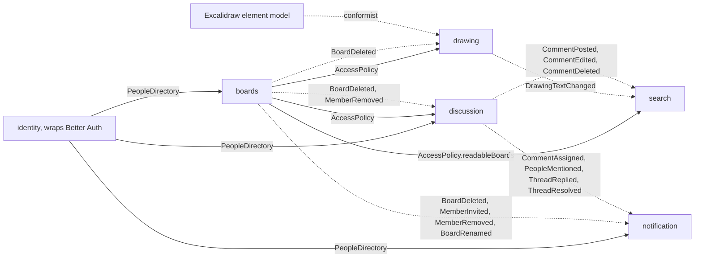

# Bounded contexts of narbel

Status: accepted by the owner on 2026-10-30, with every decision as recommended. All eight migration steps are done (2026-10-31). New work follows the contexts, events and gates described here.

This document splits the server's former `features/board` module into bounded contexts, defines how the contexts talk, and lists the current behavior that the split must keep. It also covers the matching frontend changes. Every "today" claim cites the code it comes from, so a reviewer can check it.

## Why split at all

Before step 6, `apps/server/src/features/board` held 38 use cases, 12 application ports, 4 transports (HTTP, WebSocket, MCP, file), and 5 jobs: drawing, sharing, discussion, search, and rendering. One word carries two meanings inside it. "Board" is a thing a person owns and shares, and "board" is also the document people draw on. The two meanings follow different rules: access changes never touch pages or elements, and element edits never touch access. That seam is where the first boundary goes.

The symptoms of the missing boundaries are in the code today:

- Search joins other contexts' tables in raw SQL: `DrizzleBoardSearch.ts` joins `board_access` and `comment`.
- Sharing reads Better Auth's `user` table: `DrizzleBoardAccessRepository.ts:55`.
- A repository read writes data: `findMemberRole` sets `board_access.user_id` on the first match (`DrizzleBoardAccessRepository.ts:14-43`).
- Discussion writes email rows into the outbox directly: `CommentEvents.ts:54`, `:93`.
- Rules live in use cases instead of the aggregate. The rule "a locked board needs a password" sits in `UpdateBoardAccess.ts`, while `Board.withProtection` accepts any combination.

## The contexts

| Context | Kind | Purpose | Owns these tables |
| --- | --- | --- | --- |
| `drawing` | core | The content of a board: pages, elements, images, connectors, labels, layout, and z-order. Module `live` holds sync, presence, follow, and agent selection. Module `render` draws a page to PNG for agents. | `board_document`, `board_version`, `board_file`, `user_library` |
| `boards` | supporting | A board as a thing a person owns and shares: create, rename, delete, visibility, password, members, invitations, share links, and unlock. | `board`, `board_access`, `board_share` |
| `discussion` | supporting | Threads pinned to a page: replies, mentions, reactions, assignment, and resolution. | `comment`, `comment_reaction` |
| `identity` | generic | Accounts, sessions, API keys, and MCP OAuth through Better Auth. Module `profile` holds usernames, display names, and avatars. | Better Auth tables, `profile` |
| `notification` | generic | The in-app inbox, the unread count, and email delivery through the outbox. | `notification`, `outbox` |
| `search` | supporting | A read model that answers "which boards I can read mention this text". | `board_text`, `board_text_version`, and `search_comment` |

MCP is not a context. It is a transport, like HTTP, that calls the application services of `drawing`, `discussion`, `boards`, and `search`. It has no rules of its own.

Each context gets one schema file, `packages/db/src/schema/<context>.ts`, and only that context's infrastructure may import it. Another context refers to a row only by its id.

### Cuts that were considered and rejected

| Option | Contexts | Why not |
| --- | --- | --- |
| Coarser | 4: `boards` and `drawing` merged, search as a module | Keeps the two meanings of "board" in one model, so access rules stay mixed with scene rules. |
| Finer | 8: `live`, `render`, `profile`, and `sharing` separate | `live` and `render` use the same words as `drawing` (page, element). Separating them creates two contexts that call each other on every request. |

## Ubiquitous language

The words of each context, with their meaning and the neighbour's word they must not be confused with, are in [glossary.md](glossary.md) and, for a context with its own folder, in that folder's `CONTEXT.md` (`features/boards/CONTEXT.md`, `features/drawing/CONTEXT.md`, `features/discussion/CONTEXT.md`, `features/search/CONTEXT.md`). Class, method, event, and route names come from it. A new word enters the glossary in the same pull request as the code that needs it.

## Talking across contexts

Contexts talk in two ways. A context asks another context a question through an open-host service, in-process, when the answer must be current. A context tells others what happened through an integration event.

### Ask: `AccessPolicy`, owned by `boards`

Every board request needs an access decision, including the WebSocket handshake. The decision must reflect revocation at once, because today a removed member loses access on their next request. So access stays a synchronous in-process call, not a copied projection.

```ts
type Actor =
  | { kind: "anonymous" }
  | { kind: "person"; personId: PersonId; email: Email }
  | {
      kind: "agent";
      personId: PersonId;
      email: Email;
      via: "api-key" | "oauth";
    }
  | { kind: "share-guest"; token: ShareToken }
  | { kind: "unlock-guest"; proof: UnlockProof };

type Need = "read" | "write" | "owner";

interface AccessPolicy {
  decide(
    boardId: BoardId,
    actor: Actor,
    need: Need
  ): Promise<Result<Access, AccessDenied>>;
  readableBoards(person: {
    id: PersonId;
    email: Email;
  }): Promise<ReadableBoard[]>;
  people(boardId: BoardId): Promise<{ owner: PersonId; members: Grant[] }>;
}
```

`decide` replaces `BoardAccessGuard.require` (`application/BoardAccess.ts`) for all 33 callers. `readableBoards` answers, for each live board the person owns or holds a grant on, its id, title, the person's role, visibility, and creation and last-edit times. It replaced the `readable` CTE in `DrizzleBoardSearch.ts` in step 7; `notification` reads only ids and titles from it, `search` the whole row. `people` replaces `memberIdsOf` in `BoardPeople.ts:9-17`, which discussion uses for assignees and mentions.

The decision rules move unchanged from `domain/rules/resolveAccess.ts` into the `Board` aggregate. The list in [Behavior the split must keep](#behavior-the-split-must-keep) is the acceptance test for `decide`.

### Ask: `PeopleDirectory`, owned by `identity`

`PeopleDirectory.find(ids)` and `PeopleDirectory.byUsernames(names)` replace `IProfileReader` in `shared/application/interfaces/IProfiles.ts`. Only `identity` reads the `user` and `profile` tables. `ProfileRepository.setName` writing `user.name` becomes an `identity` internal.

### Tell: integration events

An integration event is a fact one context publishes and others react to. The producer owns its type. The types are a published language in `shared/application/events/` (`DiscussionEvent.ts` today), because the dependency rules forbid one context's application layer from importing another's. Each consumer validates what it reads where it enters (`notification/infrastructure/events/`), and a payload it cannot read is parked as dead instead of retried.

Today the side effects of a comment run in the same database transaction as the comment (`CommentEvents.ts`, called inside `uow.run`). That couples two contexts in one transaction: a failed notification insert fails the comment. The proposal changes this on purpose, following the rule of one aggregate per transaction and eventual consistency between contexts:

1. The producer writes the event into the existing `outbox` table, in the same transaction as its aggregate. The event cannot be lost, and it cannot exist without the change that caused it.
2. The unit of work's `afterCommit` hook wakes the outbox worker at once, and the worker runs another pass right after an event whose consumer queued emails. The 2-second poll stays as the fallback. Measured on the local stack (5 mentions through HTTP, 2026-10-31): from the comment's HTTP response to the notification row, 14, 209, 213, 217 and 324 ms. The longer ones wait behind the previous email send in the same pass.
3. Each consumer handles an event at most once. A `processed_event(consumer, event_id)` row, written in the consumer's transaction, makes a retried delivery a no-op.
4. The worker's retry, backoff, and dead-letter rules (`OutboxWorker.ts`) apply to events as they apply to email today.

Email becomes one more consumer of the same events instead of a separate message type that use cases enqueue.

Each event carries a `type` and a `version`. A payload change that removes or renames a field needs a new version. Events carry no dedupe key: a second resolve or a later mention is news. The consumer dedupes what it sends (the email keys below) and records each event it handled in `processed_event`.

| Event | Producer | Payload | Consumers and what they do | Today |
| --- | --- | --- | --- | --- |
| `event.board-deleted` v1 | `boards` | boardId, ownerId | `drawing`: close live peers, delete the document, files, and S3 prefix. `discussion`: delete threads. `notification`: delete notifications for the board. | done in step 6 for `drawing` and `notification`; threads and the `search` rows still go by FK cascade |
| `MemberInvited` v1 | `boards` | boardId, boardTitle, email, inviteeId or null, inviterId, firstInvite | `notification`: if inviteeId is set and firstInvite, add `board.invited`. Enqueue email with dedupe key `invite:<boardId>:<email>`. | `InviteBoardMember.ts:50-70` |
| `event.member-removed` v1 | `boards` | boardId, email, personId or null | `discussion`: clear that person as assignee. `notification`: forget the invite email. `drawing.live`: re-check that person's open peers (decision 1). | done in step 6 |
| `event.access-changed` v1 | `boards` | boardId | `drawing.live`: re-check every open peer of the board (decision 1). | done in step 6 |
| `PersonDeleted` v1 | `identity` | personId | `notification`: delete the person's pending outbox rows (decision 4). | nothing |
| `event.comment-assigned` v1 | `discussion` | boardId, threadId, commentId, actor, excerpt, recipient (id, email) | `notification`: add `comment.assigned`, enqueue email `assigned:<commentId>:<assigneeId>`. | done in step 5 |
| `event.people-mentioned` v1 | `discussion` | boardId, threadId, commentId, actor, excerpt, recipients (id, email) | `notification`: one `comment.mentioned` and one email `mentioned:<commentId>:<personId>` per recipient. | done in step 5 |
| `event.thread-replied` v1 | `discussion` | boardId, threadId, commentId, actor, excerpt, recipientIds | `notification`: add `comment.reply` per recipient. | done in step 5 |
| `event.thread-resolved` v1 | `discussion` | boardId, threadId, commentId, actor, recipientIds | `notification`: add `comment.resolved` per recipient. | done in step 5 |
| `event.comment-posted`, `event.comment-edited` v1 | `discussion` | boardId, pageId, commentId, body, at | `search`: write the body into `search_comment` unless a change at a later `at` or a delete is already there. | done in step 7 |
| `event.comment-deleted` v1 | `discussion` | boardId, pageId, commentIds (the comment and, for a thread root, its replies), at | `search`: turn the rows into tombstones, which no later post or edit revives. | done in step 7, also published for a deleted person's comments (decision 4) |
| `event.drawing-text-changed` v1 | `drawing` | boardId, savedAt, texts (the full set: pageId, elementId, text) | `search`: make `board_text` equal the set unless a later `savedAt` was applied (`board_text_version`). | done in step 7 |

`BoardCreated` and `BoardRenamed` were planned so that `search` could keep its own copy of titles. Step 7 dropped them: `AccessPolicy.readableBoards` already returns the current title with every search, synchronously, so a copy would only add lag.

Discussion decides who hears about a thread: author, assignee, and mentioned people, filtered to current members. That rule moves with the events as `recipientIds`. Notification only renders and delivers.

### Context map



Solid arrows are synchronous questions. Dotted arrows are events.

`drawing` stores and sends elements in Excalidraw's shape, because the product edits Excalidraw boards and every client speaks that format. The domain does not take that shape as its model, though. One adapter, `features/drawing/application/dtos/ExcalidrawElement.ts`, parses each stored element into the domain `Element` (`features/drawing/domain/entities/Element.ts`) and writes it back: id, type, version stamps, position, size, z-order key, label link, connector ends, image file, frame, groups, lock, text, and the style fields the renderer draws. Every other Excalidraw field, and any typed field whose stored value has the wrong type, stays in an opaque `rest` that the domain carries but never reads, so writing an element back loses nothing. Rules such as connectors (`features/drawing/application/connectors.ts`, `domain/rules/bindings.ts`), labels, and layout read only the typed fields. A dependency rule keeps `@excalidraw/*` and `yjs` out of every `domain/` folder.

## Aggregates

Each aggregate is the smallest group of data that one invariant needs at the same instant. A transaction changes one aggregate. Aggregates refer to each other by id.

| Context | Aggregate | Holds | Invariants it enforces | Repository |
| --- | --- | --- | --- | --- |
| `drawing` | `Drawing` | One board's pages and elements. The Yjs document is its storage and its sync transport. | The last page cannot be deleted. Element ids are unique across pages. A label belongs to exactly one live shape. A connector end points at a live shape or at nothing. These rules live in `features/drawing/domain/entities/Drawing.ts`. | The live room (`YjsBoardHub`, behind `IBoardScenes`) loads and saves it. |
| `boards` | `Board` | Owner, title, visibility, password hash, and the share link (at most one). | A password board has a password hash. A share link expiry is in the future when set. The owner cannot hold a grant on their own board. | `BoardRepository` |
| `boards` | `Grant` | Board id, email, person id or nothing, role. | Role is `editor` or `viewer`. Claiming sets the person once and never changes it. | `GrantRepository` (unique board id and email, as the table has now) |
| `discussion` | `Thread` | The root comment: page, position, author, body, assignee, resolution. | Only the author edits the body. Only a member is assigned. Resolving twice is a no-op. | `ThreadRepository` |
| `discussion` | `Reply` | Thread id, author, body. | A reply is created only through `Thread.reply()`, so a reply to a reply cannot exist. | `ReplyRepository` |
| `discussion` | `Reaction` | Comment id, person, emoji. | Emoji is in the allow-list (`Reaction.ts`). | `ReactionRepository` |
| `identity` | `Person` | Id, name, username, avatar key. | A username is set once and matches `^[a-z0-9_]{3,20}$`. | `PersonRepository` (maps Better Auth's `user` and `profile`) |

`notification` and `search` are generic and supporting contexts with no invariants worth an aggregate. They stay plain records and queries.

`UpdateBoardAccess` saves the board and the share link together today (`UpdateBoardAccess.ts`). Folding the share link into `Board` keeps that a one-aggregate transaction. `Thread` and `Reply` are separate so that a busy thread does not load every reply to add one.

Value objects replace the raw strings that carry rules: `BoardId`, `PageId`, `ElementId`, `ElementKey`, `PersonId`, `Email`, `Username`, `Role`, `ShareToken`, `BoardTitle` (exists), and `CommentBody`.

## Deleting a board

Deleting a board is two steps. `TrashBoard` sets `board.trashed_at`, saves the live room, sends every connected peer away on every instance, and hides the board from lists, search, notifications, MCP, files and previews. Everyone who could open it while it was live gets HTTP 410 (their local IndexedDB copy is kept), everyone else 404. `RestoreBoard` clears the column and changes nothing else. Only the owner can then run `PurgeBoard`, which refuses a live board. There is no automatic purge of old trash.

Before step 6, `PurgeBoard` deleted, in one transaction and only while the board was still in Trash, the board's notifications and the board row, then closed the live room and deleted the S3 prefix.

Since step 6, `boards` deletes the `Board` aggregate and writes `event.board-deleted` (version 1, boardId, ownerId) to the outbox in the same transaction (`features/boards/application/usecases/PurgeBoard.ts`). Each consumer handles it once, marked in `processed_event`: `drawing` (`DeleteDrawing`) deletes its document, versions and file rows, discards the live room on the instance that runs the consumer, and deletes the S3 prefix, inside its transaction so a failed delete leaves the event to be retried; `notification` (`DropBoardNotifications`) deletes the board's notifications. The S3 delete now runs after the board row is gone, which closes the gap where an S3 delete succeeded and the transaction then failed. `discussion` and `search` have no consumer: the cross-context foreign keys stay in the schema during the migration (`packages/db/src/schema/discussion.ts`, `drawing.ts`, `search.ts`), so the database still deletes grants, share link, comments, reactions, document, versions, text, search comments, and files at once, and the `drawing` consumer finds nothing left. A text or comment event that reaches `search` after the purge fails its foreign key, and the consumer takes that as done. The keys can go later, when each consumer has a test that proves it deletes its rows.

## Behavior the split must keep

The split changes structure, plus the behavior that decisions 1, 3, 4, 5, and 6 change. Each item below gets a test before its code moves.

1. Guests get the viewer role at most, even with an editor share link (`resolveAccess.ts`).
2. A board the actor cannot read answers `NotFound`. A password board answers `Forbidden` with `passwordRequired: true`, except for `owner` needs (`BoardAccess.ts:44-53`).
3. A non-owner asking for `owner` gets `NotFound`, so the board stays hidden.
4. A viewer asking for `write` gets `Forbidden` "This board is read-only for you" (`BoardAccess.ts:58-59`).
5. A share link with `expiresAt` in the past grants nothing (`resolveAccess.ts`).
6. Changing the password invalidates every unlock cookie, because the HMAC covers the hash (`HmacUnlockTokens.ts`).
7. The first access by a signed-in person whose email has an invitation attaches the person to the grant (`DrizzleBoardAccessRepository.ts:14-43`). This becomes an explicit `claimInvitation` step inside `decide`, still at the same moment.
8. Removing a member clears them as assignee and forgets their invite email. Since step 6, `RemoveBoardMember` publishes `event.member-removed` in its transaction, and both happen when the event reaches `discussion` (`UnassignRemovedMember`) and `notification` (`ForgetRemovedInvite`), each in its own transaction with its own `processed_event` mark (decision 6).
9. Since step 6, removing a member or changing access (`UpdateBoardAccess` on visibility, password or share link; `InviteBoardMember` when a grant's role changes) publishes an event that `drawing.live` turns into a recheck on every instance (`recheckBoardPeers` in `YjsBoardHub.ts`). Each open peer is decided again with the actor it connected as: a peer that lost read access is closed with code 1008 and reason `access-revoked` (the web client stops reconnecting and reloads the board, which shows the 404 or password screen); a peer that lost write access stays connected as read-only; a peer that gained it may write again (decision 1).
10. Read-only peers still broadcast presence (awareness), but their document updates are dropped (`YjsBoardHub.ts:388-395`).
11. Email goes through the outbox with the same dedupe keys: `assigned:<commentId>:<personId>`, `mentioned:<commentId>:<personId>`, and `invite:<boardId>:<email>`. The same people get the same notifications. Only the timing changes from "inside the comment's transaction" to "after it commits" (decision 6).
12. Only the author edits a comment. The author or the owner deletes it. Any reader can react (`EditComment.ts:44`, `DeleteComment.ts:33-38`, `SetCommentReaction.ts`).
13. An assignee must be a member (`AddComment`, `AssignComment.ts`).
14. Deleting a board deletes its notifications for every user (`DrizzleNotificationRepository.ts`). Since step 6 this happens when `event.board-deleted` reaches `notification` (`DropBoardNotifications`).

Item 10 is endorsed by decision 2. Item 9 changes by decision 1.

## Frontend

The frontend follows the same contexts. The entities are `board` (boards a person owns or shares: read queries, query keys, types), `drawing` (`entities/drawing`: element keys per page and the per-user IndexedDB board cache, moved from `shared/lib/page-keys.ts` and `shared/lib/board-cache.ts`), and `person` (the former `entities/user`), next to `session`. There is no `thread` entity yet: comment and thread reads are used only by `features/board-comments`, so they stay there. Mutations live in the feature that runs them: rename in `rename-board`, restore in `trash-board`, access, invite, remove member and unlock in `share-board`, and search in `search-boards`. Create, trash and purge stay in `entities/board` because both their own feature and `import-board` run them.

### Hooks from `@reactuses/core`

The app already depends on `@reactuses/core` 6.6.1 and uses only `useClipboard`. The names below are the names in 6.6.1. The reactuse website lists newer names, such as `useDebounceValue` and `useThrottleCallback`, that 6.6.1 does not export.

| Hand-written today | Replace with |
| --- | --- |
| `shared/lib/use-debounced.ts` | `useDebounce` |
| `shared/lib/use-load-more.ts` | `useIntersectionObserver` |
| `matchMedia("(prefers-reduced-motion: reduce)")` in components (`pages-bar.tsx:43`, `agent-focus.ts:53`) | `useReducedMotion`. `router.tsx` keeps `matchMedia` because it runs outside React. |
| `ResizeObserver` and `resize` or `scroll` listeners (`comments-layer.tsx:201`, `:279`, `pages-bar.tsx:257`) | `useResizeObserver` and `useEventListener` |
| `document.addEventListener` in `use-presence.ts:148-150` | `useEventListener` with `document` as the target |
| `EventSource` in `features/notifications/api/notifications.ts:48-57` | `useEventSource` with `withCredentials` and the `notification` event, moved to `model/` |

`createThrottleLatest` stays. It was compared with lodash's `throttle`, which `useThrottleFn` wraps, on a virtual clock with 7 input traces:

- Same output in 4 traces: one value, values exactly 33 ms apart, two values 500 ms apart, and a cancel before the trailing value.
- 60 Hz pointer input for 500 ms: `createThrottleLatest` sends every 33 ms, 16 values. Lodash sends at 33 ms and 47 ms gaps in turn, 13 values, about 27 Hz.
- The last value of a burst arrives up to 7 ms later with lodash.

The cursor path needs the steady 33 ms rhythm that Excalidraw's own collaboration uses (`CURSOR_SYNC_TIMEOUT = 33`), so the hand-written helper earns its 40 lines.

oxlint 1.90 has no `no-restricted-syntax`, so the redproof gate `web-hooks` (`gates/web-hooks.ts`, scanner `gate-checks/web-hooks.ts`) bans `new ResizeObserver`, `new IntersectionObserver`, `new EventSource`, and `.addEventListener(` in `apps/web/src/**` outside tests, with a message that names the hook to use. Its allowlist names each exempt file and why: `entities/drawing/model/board-cache.ts`, because IndexedDB requests are not DOM events; the vendored stickers; the comments sheet, whose panel mounts in the same commit that opens it while `useEventListener` resolves its target during render; and the compact-chrome measure, which observes up to five elements with one observer.

## Decisions

The owner accepted all six on 2026-10-30. Each one names the migration step that carries it out.

1. **Close the WebSocket of a removed member.** Accepted. `drawing.live` handles `MemberRemoved` and `AccessChanged`, calls `AccessPolicy.decide` again for every open peer of the board, closes a peer that lost read access with code 1008, and lowers a peer that lost write access to read-only. Step 6.
2. **Keep presence from read-only peers.** Accepted. Viewers are people in the room, so their cursors stay visible. Item 10 stays as it is.
3. **Re-check access when listing notifications.** Accepted. `notification` asks `AccessPolicy.readableBoardIds` when it lists, and hides notifications for boards the person can no longer read. `board.invited` shows the current title. Step 4.
4. **Clean up after a deleted person.** Accepted. `identity` publishes `PersonDeleted` from Better Auth's delete hook. `identity` deletes the avatar from S3, and `notification` deletes the person's pending outbox rows. Step 4.
5. **Unlock rate limit key.** Accepted. The key uses the client address that the trusted proxy reports, and `x-forwarded-for` counts only when the request comes from that proxy. Step 1.
6. **Eventual consistency between contexts.** Accepted. Events go through the outbox, as described in [Tell: integration events](#tell-integration-events). Step 5.

## Migration order

Each step is one pull request. The tests from [Behavior the split must keep](#behavior-the-split-must-keep) pass, behavior changes only where a decision says so, and the dependency rules for the moved context are on before the next step starts. The owner confirms each step before it starts.

1. Done (2026-10-30). CI runs every redproof gate on push and pull request, `main` requires the `redproof` check, and the unlock and sign-in rate limits key on the client address that the trusted proxy appends (decision 5).
2. Done (2026-10-30). This document and [glossary.md](glossary.md), one section per context.
3. Dependency rules: a context imports another only through its `index.ts`. Only the owning context imports a schema file. No `@excalidraw/*` or `yjs` in `domain/`. No port interfaces in `infrastructure/`.
4. Done (2026-10-31). The Drizzle profile and notification repositories live in their features; the schema-owner rules now allow `features/profile` (identity's profile module). The notification list re-checks access through `readableBoards` from `features/board`'s public API (now `features/boards`) and shows an invitation under the board's current title (decision 3). Deleting a person runs a Better Auth `delete.before` hook that removes the avatar and drops the person's pending outbox emails (decision 4); it becomes the `PersonDeleted` event when identity publishes events.
5. Done (2026-10-31). `features/discussion` owns comments, replies and reactions, with `schema/discussion.ts` and its owner rule. The `Thread` aggregate (`domain/entities/Thread.ts`) holds the rules that sat in use cases: an assignee must be a member, only the author edits, the author or owner deletes, replies are created only through `replyTo`, resolve and reopen are idempotent. Comment side effects are the four events above, consumed by `notification` once per event; a recipient deleted in between is skipped. Discussion reaches boards only through its own ports (`IBoardAccess`, `IBoardMembers`), and boards reaches discussion through `ICommentActivity` and `ICommentAssignees`. `Actor` and the request helpers moved to `shared/`. Reactions stay a value checked against the allow-list, with one row per person, comment and emoji.
6. Done (2026-10-31). `features/board` is gone. 6a: `AccessPolicy` (`features/boards/application/AccessPolicy.ts`) replaced `BoardAccessGuard`, the `Board` aggregate owns the access rules, and claiming an invitation is an explicit step inside `decide`. 6b: `RemoveBoardMember`, `UpdateBoardAccess` and a role change in `InviteBoardMember` publish `event.member-removed` and `event.access-changed`, which `drawing.live` turns into a recheck of every open peer on every instance (decision 1), and `discussion` and `notification` consume `event.member-removed`. 6c: the domain reads elements through the typed `Element` behind one Excalidraw adapter. 6d: the server splits into `features/boards` (lifecycle, access, members, share links, unlock, and search until step 7), `features/drawing` (pages, elements, images, versions, library, export, changes, the live rooms and presence, rendering, the file sweep and text backfill, and the `Drawing` rules in `domain/entities/Drawing.ts`), and `features/mcp`, a transport over the public `index.ts` of boards, drawing and discussion. Drawing reaches boards only through its ports `IBoardAccess` and `IBoardRecords` (`application/ports/IBoardAccess.ts`); boards reaches drawing only through `ILiveDrawings` (Trash still evicts at once with close code 4410) and `IDrawingCopier` (`DuplicateBoard` stays in boards and lets `CopyDrawing` copy the content); `bootstrap/app.ts` and `main.ts` wire them. Purging publishes `event.board-deleted` as described in [Deleting a board](#deleting-a-board). `schema/board.ts` split into `boards.ts`, `drawing.ts` and `search.ts` with one owner rule each and no database change; `DrizzleBoardAccessRepository` keeps its read of `user` by email until `PeopleDirectory` answers by email.
7. Done (2026-10-31). `features/search` owns search: `SearchBoards`, the `GET /api/boards/search` route (same path and response), and the MCP tool `search_boards` through its public `index.ts`. It reads only its own tables (`schema/search.ts`, owner rule `features/search`) plus `AccessPolicy.readableBoards` through its port `IReadableBoards`: titles match in memory with the same rule as the old `ILIKE` (any case, wildcards literal), and text and comment matches are restricted to the readable ids in one query, so ranking stays title matches first, then the newest, 20 boards and 3 matches each. `drawing` no longer writes `board_text`: a save whose text changed publishes `event.drawing-text-changed` with the full set in its transaction, and the startup backfill publishes one per board whose `text_indexed` is false. `discussion` publishes `event.comment-posted`, `event.comment-edited` and `event.comment-deleted` in the transaction of the change; `DeleteComment` now runs in a unit of work. A deleted person's comments still go with the user row by foreign-key cascade, and `search_comment.comment_id` cascades with its comment, so no mirror row outlives its comment. Search's two consumers (`IndexDrawingText`, `IndexComment`, marked under `search` in `processed_event`) apply a change only over an older one: `board_text_version` holds the last applied save time per board, and `search_comment` keeps `changed_at` and a null body as a tombstone. Existing comments were copied into `search_comment` by the migration, which sits outside the context rules. The `search` and `discussion` words moved from the glossary into their `CONTEXT.md`.
8. Done (2026-10-31). Web entities follow the contexts (`entities/board`, `entities/drawing` with page keys and the offline cache, `entities/person`, `entities/session`); board mutations live in the features that use them, except create, trash and purge, which `import-board` shares. Hand-written observers, listeners and the notification `EventSource` in React code use `@reactuses/core`; the `web-hooks` gate refuses new ones outside an allowlist that names its reason per file. `createThrottleLatest` stays, as measured.
